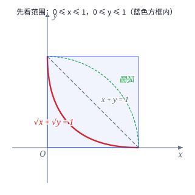
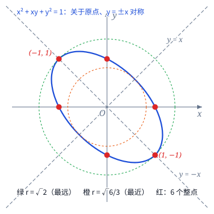
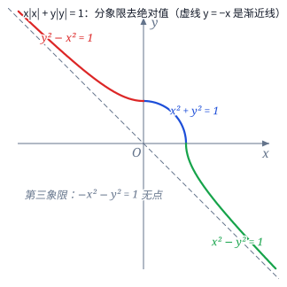
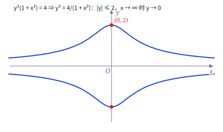

# 陌生曲线的七个分析角度（含自编例子）

> **来源**：补充专题（陌生曲线的性质分析 1/3） ｜ **适用模块**：八、曲线与方程

*(多选题、填空题常给一条没见过的曲线（四叶草、双纽线、「丝带」曲线……），问它过几个整点、有几条对称轴、到原点的距离范围、围成的面积。这类题不需要画出精确图形，按下面七个角度逐条检查即可。本专题三条：第 1 条把七个角度展开讲清楚并各配例子，第 2、3 条是课堂上的 8 道例题。)*

## 总表

| 角度 | 怎么做 | 常见陷阱 |
| --- | --- | --- |
| (1) 取值范围 | 看根号、分式、平方、绝对值隐含的范围；或把方程看成关于 $y$ 的二次方程，用 $\Delta \ge 0$ | 漏掉 $\sqrt{\ }$ 带来的非负 |
| (2) 对称性 | 把 $(-x, y)$、$(x, -y)$、$(-x, -y)$、$(y, x)$、$(-y, -x)$ 代入，看方程变不变 | 只查坐标轴，漏查 $y = \pm x$ |
| (3) 与坐标轴的交点 | 令 $x = 0$、$y = 0$ 解方程 | 原点常常在曲线上 |
| (4) 到原点的距离 | 凑出 $x^2 + y^2$，用不等式或联立 $x^2 + y^2 = r^2$ | 等号能否取到 |
| (5) 绝对值 | 分象限（分区域）去绝对值，每块是熟悉的曲线 | 某些象限可能没有点 |
| (6) 整点个数 | 先用范围把曲线框住，再逐个试 | 漏掉坐标轴上的整点 |
| (7) 单调性、最值 | 分离变量，把 $y$（或 $y^2$）写成 $x$ 的函数，必要时求导 | 「最高点」不一定在看起来的地方 |

下面每个角度各配一个例子，(2)(3)(4)(6) 用同一条曲线 $x^2 + xy + y^2 = 1$ 连起来讲。

## (1) 取值范围：先把曲线「框住」

**例 A**　曲线 $\sqrt{x} + \sqrt{y} = 1$ 是不是四分之一个圆？

**分析**：先看范围，$x \ge 0$，$y \ge 0$，且 $\sqrt{x} \le 1$、$\sqrt{y} \le 1$，所以曲线被框在正方形 $[0, 1] \times [0, 1]$ 里，端点是 $(1, 0)$、$(0, 1)$。

再取中点检验：$x = y$ 时 $2\sqrt{x} = 1$，$x = \frac{1}{4}$，点 $\left(\frac{1}{4}, \frac{1}{4}\right)$ 在直线 $x + y = 1$ 的==下方==，而四分之一圆的中点 $\left(\frac{\sqrt{2}}{2}, \frac{\sqrt{2}}{2}\right)$ 在上方。所以它==向原点凹进去，不是圆弧==（其实是抛物线的一段）。

**用 $\Delta$ 求范围**：方程能看成关于 $y$ 的二次方程时，判别式 $\Delta \ge 0$ 给出 $x$ 的范围。例如 $x^2 + xy + y^2 = 1$ 看成 $y^2 + xy + (x^2 - 1) = 0$，$\Delta = 4 - 3x^2 \ge 0$，所以 ==$|x| \le \frac{2\sqrt{3}}{3}$==，同理 $|y| \le \frac{2\sqrt{3}}{3}$。

## (2) 对称性：五种代换

设 $(m, n)$ 满足方程，检查下面的点是否也满足：

| 代入 | 若方程不变，则曲线关于……对称 |
| --- | --- |
| $(-m, n)$ | $y$ 轴 |
| $(m, -n)$ | $x$ 轴 |
| $(-m, -n)$ | 原点 |
| $(n, m)$（$x$、$y$ 互换） | 直线 $y = x$ |
| $(-n, -m)$ | 直线 $y = -x$ |

方程里 $x$、$y$ 都只以 $x^2$、$y^2$、$|x|$、$|y|$ 的形式出现，就同时关于两轴和原点对称；方程关于 $x$、$y$ 对称（互换不变），就关于 $y = x$ 对称。

**例 B**　研究曲线 $C$：$x^2 + xy + y^2 = 1$。

**对称性**：$(-m, n)$ 代入得 $m^2 - mn + n^2$，变了，所以==不关于 $y$ 轴、$x$ 轴对称==；$(-m, -n)$ 代入不变，==关于原点对称==；互换 $m$、$n$ 不变，==关于 $y = x$ 对称==；$(-n, -m)$ 代入得 $n^2 + nm + m^2$，不变，==关于 $y = -x$ 也对称==。它其实是一个长轴在 $y = -x$ 上的斜椭圆。

## (3) 与坐标轴的交点

例 B 中令 $y = 0$ 得 $x = \pm 1$，令 $x = 0$ 得 $y = \pm 1$，交点为 $(\pm 1, 0)$、$(0, \pm 1)$。

## (4) 到原点的距离：凑出 $x^2 + y^2$

例 B 中设 $d^2 = x^2 + y^2$，方程变为 $d^2 + xy = 1$。用 $|xy| \le \frac{x^2 + y^2}{2} = \frac{d^2}{2}$：

- $xy \ge -\frac{d^2}{2}$，所以 $1 = d^2 + xy \ge \frac{d^2}{2}$，$d^2 \le 2$；等号在 $x = -y$ 时，如 $(1, -1)$。
- $xy \le \frac{d^2}{2}$，所以 $1 \le \frac{3d^2}{2}$，$d^2 \ge \frac{2}{3}$；等号在 $x = y = \frac{\sqrt{3}}{3}$ 时。

所以曲线上的点到原点的距离 ==$d \in \left[\frac{\sqrt{6}}{3}, \sqrt{2}\right]$==。另一种做法是令 $x = d\cos \theta$、$y = d\sin \theta$ 代入，得 $d^2\left(1 + \frac{1}{2}\sin 2\theta\right) = 1$，再看 $\sin 2\theta$ 的范围。

## (5) 绝对值：分象限

**例 C**　画出曲线 $x|x| + y|y| = 1$。

**分析**：分四个象限（含坐标轴）去绝对值：

| 区域 | 方程 | 图形 |
| --- | --- | --- |
| $x \ge 0$，$y \ge 0$ | $x^2 + y^2 = 1$ | 四分之一圆 |
| $x < 0$，$y > 0$ | $y^2 - x^2 = 1$ | 双曲线上支的左半 |
| $x > 0$，$y < 0$ | $x^2 - y^2 = 1$ | 双曲线右支的下半 |
| $x < 0$，$y < 0$ | $-x^2 - y^2 = 1$ | ==无点== |

拼起来是一条从左上到右下的连续曲线，以 $y = -x$ 为渐近线。它也是一个函数的图象（每个 $x$ 只对应一个 $y$），而且==单调递减==。课堂例 2 的 $\frac{x^2}{4} + y|y| = 1$ 就是这个套路。

## (6) 整点个数：先框范围，再逐个试

例 B 中由 (1) 知 $|x| \le \frac{2\sqrt{3}}{3} < 2$，所以整点的横、纵坐标只能取 $-1$、$0$、$1$，共 $9$ 个候选点逐个代入：$(\pm 1, 0)$、$(0, \pm 1)$、$(1, -1)$、$(-1, 1)$ 满足，$(1, 1)$、$(-1, -1)$、$(0, 0)$ 不满足。共 ==$6$ 个整点==（图中红点）。

## (7) 单调性、最值：分离变量看成函数

**例 D**　曲线 $y^2(1 + x^2) = 4$ 上的点纵坐标的取值范围是什么？

**分析**：分离出 $y^2 = \frac{4}{1 + x^2}$。$1 + x^2 \ge 1$，所以 $0 < y^2 \le 4$，$y \in [-2, 0) \cup (0, 2]$，最高点 $(0, 2)$；$x \to \infty$ 时 $y \to 0$，$x$ 轴是渐近线。再结合对称性（关于两轴、原点对称），整条曲线的形状就清楚了。

分离后的函数不好看时，就求导（课堂例 8 的 C 选项）。
