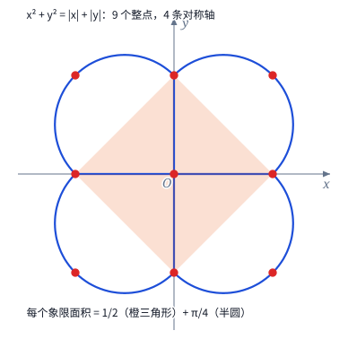
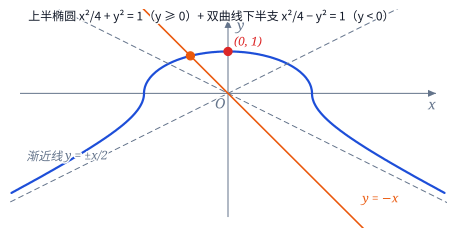
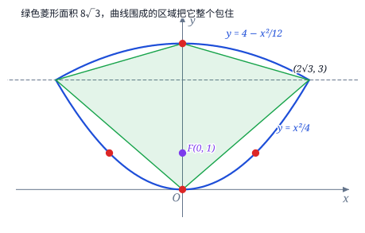
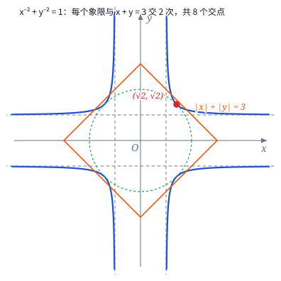

# 陌生曲线例题（一）：四叶草、分段函数曲线、两段抛物线、x⁻² + y⁻² = 1

> **来源**：补充专题（陌生曲线的性质分析 2/3） ｜ **适用模块**：八、曲线与方程

**例 1**（多选）　已知曲线 $C$ 的方程是 $x^2 + y^2 = |x| + |y|$，以下结论正确的有（　）

A．曲线 $C$ 恰好经过 $4$ 个整点（即横、纵坐标均为整数的点）

B．曲线 $C$ 有 $4$ 条对称轴

C．曲线 $C$ 上任意一点到原点的距离都不小于 $1$

D．曲线 $C$ 所围成图形的面积大于 $4$

**解**：先用角度 (5) 分象限：第一象限 $x^2 + y^2 = x + y$，即 $\left(x - \frac{1}{2}\right)^2 + \left(y - \frac{1}{2}\right)^2 = \frac{1}{2}$，是过原点、$(1, 0)$、$(0, 1)$ 的圆，取第一象限内的那段弧。四个象限拼成「四叶草」。

- **A**（角度 (6)）：范围 $|x|, |y| \le \frac{1 + \sqrt{2}}{2} < 2$，候选整点坐标只取 $-1$、$0$、$1$。逐个检验：$(0, 0)$、$(\pm 1, 0)$、$(0, \pm 1)$、$(\pm 1, \pm 1)$ 共 ==$9$ 个==都满足。A 错。
- **B**（角度 (2)）：若 $(m, n)$ 在曲线上，$(-m, n)$、$(m, -n)$ 代入不变，关于两轴对称；互换 $m$、$n$ 不变，关于 $y = x$ 对称；$(-n, -m)$ 也不变，关于 $y = -x$ 对称。共 $4$ 条。B 对。
- **C**（角度 (3)）：原点 $(0, 0)$ 在曲线上，距离为 $0$。C 错。
- **D**：每个象限的面积 = 直角三角形 $\frac{1}{2} \times 1 \times 1$ + 半圆 $\frac{1}{2}\pi\left(\frac{\sqrt{2}}{2}\right)^2 = \frac{1}{2} + \frac{\pi}{4}$，总面积 $4\left(\frac{1}{2} + \frac{\pi}{4}\right) = 2 + \pi > 4$。D 对。

答案 ==BD==。

**例 2**（多选）　方程 $\frac{x^2}{4} + y|y| = 1$ 所对应曲线与函数 $y = f(x)$ 图象完全重合，则以下结论正确的有（　）

A．函数 $f(x)$ 在 R 上单调递减

B．$y = f(x)$ 的图象上的点到坐标原点距离的最小值为 $1$

C．函数 $f(x)$ 的值域为 $(-\infty, 2]$

D．函数 $F(x) = f(x) + x$ 有且只有一个零点

**解**：按 $y$ 的正负去绝对值：

- $y \ge 0$：$\frac{x^2}{4} + y^2 = 1$，椭圆的上半部分（$-2 \le x \le 2$）；
- $y < 0$：$\frac{x^2}{4} - y^2 = 1$，双曲线在 $x$ 轴下方的部分（$|x| > 2$），渐近线 $y = \pm\frac{1}{2}x$。

逐项看：

- **A**：$x < 0$ 时上半椭圆是递增的。A 错。
- **B**：椭圆部分到原点距离最小为短半轴 $1$（点 $(0, 1)$）；双曲线部分 $|x| > 2$，距离大于 $2$。最小值为 $1$。B 对。
- **C**：最大值是 $f(0) = 1$，向两边无限下降，值域为 ==$(-\infty, 1]$==，不是 $(-\infty, 2]$。C 错。
- **D**：零点就是 $f(x) = -x$，即曲线与直线 $y = -x$ 的交点。$x < 0$ 时 $y = -x$ 与上半椭圆恰有一个交点；$x > 2$ 时双曲线部分满足 $|y| < \frac{x}{2} < x$，所以 $y > -x$，没有交点；$x \le -2$ 时曲线在 $x$ 轴下方而 $-x > 0$，也没有交点。D 对。

答案 ==BD==。

**例 3**（多选）　在平面直角坐标系内，动点 $M$ 与定点 $F(0, 1)$ 的距离和 $M$ 到定直线 $l$：$y = 3$ 的距离的和为 $4$。记动点 $M$ 的轨迹为曲线 $W$，以下结论正确的有（　）

A．曲线 $W$ 过原点

B．曲线 $W$ 是轴对称图形，也是中心对称图形

C．曲线 $W$ 恰好经过 $4$ 个整点

D．曲线 $W$ 围成区域的面积大于 $8\sqrt{3}$

**解**：设 $M(x, y)$，$\sqrt{x^2 + (y - 1)^2} + |y - 3| = 4$。分 $y$ 与 $3$ 的大小去绝对值：

- $y \ge 3$：$\sqrt{x^2 + (y - 1)^2} = 7 - y$，平方得 $x^2 = 48 - 12y$，即 $y = 4 - \frac{x^2}{12}$；
- $y < 3$：$\sqrt{x^2 + (y - 1)^2} = y + 1$，平方得 $x^2 = 4y$，即 $y = \frac{x^2}{4}$。

两段在 $y = 3$ 处衔接，$x = \pm 2\sqrt{3}$。$W$ 是两段抛物线围成的封闭曲线。

- **A**：$(0, 0)$ 满足 $y = \frac{x^2}{4}$。A 对。
- **B**：关于 $y$ 轴对称，但上下两段不一样，不是中心对称图形。B 错。
- **C**：$|x| \le 2\sqrt{3} < 4$。下段 $y = \frac{x^2}{4}$ 取整数要求 $x$ 为偶数：$(0, 0)$、$(\pm 2, 1)$；上段 $y = 4 - \frac{x^2}{12}$ 只有 $x = 0$：$(0, 4)$。共 $4$ 个。C 对。
- **D**：以 $(0, 0)$、$(2\sqrt{3}, 3)$、$(0, 4)$、$(-2\sqrt{3}, 3)$ 为顶点的四边形面积 $\frac{1}{2} \times 4 \times 4\sqrt{3} = 8\sqrt{3}$，曲线是凸的，围成的区域严格包含这个四边形，面积大于 $8\sqrt{3}$。D 对。

答案 ==ACD==。

**例 4**　对于曲线 $C$：$x^{-2} + y^{-2} = 1$，下列三个命题中正确的有______。

①关于坐标原点对称；②曲线 $C$ 上任意一点到坐标原点的距离不小于 $2$；③曲线 $C$ 与曲线 $|x| + |y| = 3$ 有四个交点。

**解**：先看范围：$\frac{1}{x^2} = 1 - \frac{1}{y^2} < 1$，所以 $x^2 > 1$，同理 $y^2 > 1$，曲线在四个「角」里，以 $x = \pm 1$、$y = \pm 1$ 为渐近线。

- **①**：只含 $x^2$、$y^2$，关于原点对称。对。
- **②**：凑 $x^2 + y^2$：$d^2 = (x^2 + y^2)\left(\frac{1}{x^2} + \frac{1}{y^2}\right) = 2 + \frac{y^2}{x^2} + \frac{x^2}{y^2} \ge 4$，所以 $d \ge 2$，在 $(\pm\sqrt{2}, \pm\sqrt{2})$ 处取等。对。
- **③**：看第一象限。曲线上离原点最近的点 $(\sqrt{2}, \sqrt{2})$ 满足 $x + y = 2\sqrt{2} < 3$，在直线 $x + y = 3$ 的下方；而 $x \to 1^+$ 时 $y \to +\infty$，曲线又跑到直线上方，$y \to 1^+$ 时同理。所以第一象限有 $2$ 个交点，四个象限共 $8$ 个。错。

答案 ==①②==。
