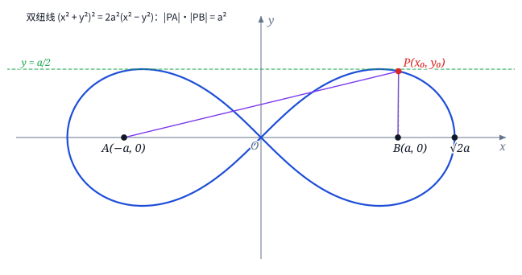
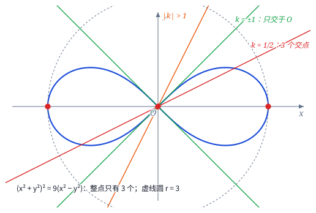
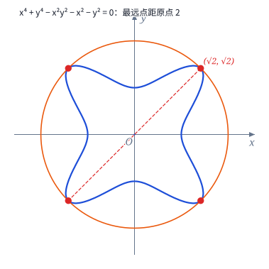
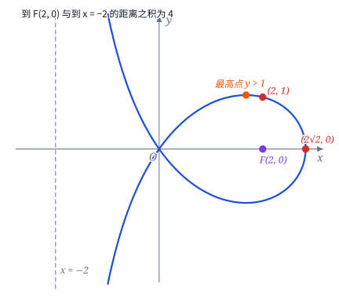

# 陌生曲线例题（二）：双纽线、最小覆盖圆、2024 新课标 Ⅰ 卷「丝带」曲线

> **来源**：补充专题（陌生曲线的性质分析 3/3） ｜ **适用模块**：八、曲线与方程

**例 5**　数学中有许多形状优美、应用广泛的曲线。双纽线 $C$：$(x^2 + y^2)^2 = 2a^2(x^2 - y^2)$ 就是其中之一（如图），其定义为：在平面内，到两个定点 $A(-a, 0)$ 和 $B(a, 0)$（$a > 0$）的距离之积为常数 $a^2$ 的点的轨迹。设 $P(x_0, y_0)$（$y_0 \ne 0$）为 $C$ 上一点，给出下列四个结论：

①$|x_0| \le \sqrt{2}a$；②$|y_0| \le \frac{a}{2}$；③若点 $P$ 在第一象限，则 $|OP| < \sqrt{2}x_0$；④$\triangle PAB$ 的周长可以等于 $5a$。

其中所有正确结论的序号是______。

**解**：记 $|PA| = m$，$|PB| = n$，$mn = a^2$，$\angle APB = \theta$。

- **①**（角度 (3)(4)）：令 $y = 0$，$x^4 = 2a^2x^2$，$|x| = \sqrt{2}a$，这是曲线最左、最右的点。一般地，$x^2 - y^2 \le x^2 + y^2$，所以 $(x^2 + y^2)^2 \le 2a^2(x^2 + y^2)$，$x^2 + y^2 \le 2a^2$，于是 $|x_0| \le \sqrt{2}a$。对。
- **②**（面积算两遍）：$S_{\triangle PAB} = \frac{1}{2} \cdot 2a \cdot |y_0| = \frac{1}{2}mn\sin \theta = \frac{1}{2}a^2\sin \theta$，所以 $|y_0| = \frac{a}{2}\sin \theta \le \frac{a}{2}$。对。
- **③**：$|OP| < \sqrt{2}x_0 \Leftrightarrow x_0^2 + y_0^2 < 2x_0^2 \Leftrightarrow y_0^2 < x_0^2$。而方程左边 $(x_0^2 + y_0^2)^2 > 0$（$P$ 不是原点），所以右边 $2a^2(x_0^2 - y_0^2) > 0$，即 $x_0^2 > y_0^2$。对。
- **④**：周长 $5a$ 即 $m + n = 3a$。余弦定理：$4a^2 = m^2 + n^2 - 2mn\cos \theta = (m + n)^2 - 2mn - 2mn\cos \theta = 9a^2 - 2a^2 - 2a^2\cos \theta$，得 $\cos \theta = \frac{3}{2} > 1$，不可能。错。

答案 ==①②③==。

**例 6**　已知曲线 $C$：$(x^2 + y^2)^2 = 9(x^2 - y^2)$ 是双纽线，则下列结论正确的是（　）

A．曲线 $C$ 的图象不关于原点对称

B．曲线 $C$ 经过 $4$ 个整点（横、纵坐标均为整数的点）

C．若直线 $y = kx$ 与曲线 $C$ 只有一个交点，则实数 $k$ 的取值范围为 $(-\infty, -1]$

D．曲线 $C$ 上任意一点到坐标原点 $O$ 的距离都不超过 $3$

**解**：

- **A**：只含 $x^2$、$y^2$，关于原点对称。A 错。
- **B**：由 D 的结论 $x^2 + y^2 \le 9$。$y = 0$ 时 $x^4 = 9x^2$，$x = 0$ 或 $\pm 3$；其余候选点如 $(\pm 1, 0)$、$(\pm 2, 0)$、$(\pm 1, \pm 1)$、$(\pm 2, \pm 1)$、$(\pm 2, \pm 2)$ 代入都不成立（例如 $(2, 1)$：左边 $25$，右边 $27$）。只有 $(0, 0)$、$(\pm 3, 0)$ 共 $3$ 个。B 错。
- **C**：联立 $y = kx$：$x^4(1 + k^2)^2 = 9x^2(1 - k^2)$。$x = 0$ 总是一个解（原点）。只有一个交点，要求 $x^2 = \frac{9(1 - k^2)}{(1 + k^2)^2}$ 没有非零解，即 $1 - k^2 \le 0$，$k \le -1$ 或 $k \ge 1$。C 只写了一半，错。
- **D**（角度 (4)）：$d^2 = x^2 + y^2 = \frac{9(x^2 - y^2)}{x^2 + y^2} \le 9$（原点处 $d = 0$），$d \le 3$。D 对。

答案 ==D==。

**例 7**　对于一个平面图形，如果存在一个圆能完全覆盖住这个平面图形，则称这个图形被这个圆完全覆盖，其中能覆盖平面图形的最小圆称为最小覆盖圆。则曲线 $x^4 + y^4 - x^2y^2 - x^2 - y^2 = 0$ 的最小覆盖圆的半径为______。

**解**：先看对称性：只含 $x^2$、$y^2$，且 $x$、$y$ 互换不变，所以关于两轴、$y = \pm x$、原点都对称，最小覆盖圆的圆心就是原点，半径是曲线上的点到原点距离的最大值。

设 $D = x^2 + y^2$（角度 (4)），方程变为 $x^4 + y^4 - x^2y^2 = D$，而 $x^4 + y^4 = D^2 - 2x^2y^2$，所以

$$D^2 - 3x^2y^2 = D \;\Rightarrow\; D^2 - D = 3x^2y^2 \le 3\left(\frac{x^2 + y^2}{2}\right)^2 = \frac{3}{4}D^2$$

得 $\frac{1}{4}D^2 \le D$，$D \le 4$，距离 $d \le 2$。等号在 $x^2 = y^2 = 2$ 时取到，代入验证 $4 + 4 - 4 - 2 - 2 = 0$ 成立。$(\sqrt{2}, \sqrt{2})$ 与 $(-\sqrt{2}, -\sqrt{2})$ 相距 $4$，任何覆盖圆的直径都至少是 $4$，所以最小覆盖圆的半径为 ==$2$==。

**例 8**（2024 新课标 Ⅰ 卷 11，多选）　造型「$\infty$」可以做成美丽的丝带，将其看作图中曲线 $C$ 的一部分。已知 $C$ 过坐标原点 $O$，且 $C$ 上的点满足横坐标大于 $-2$，到点 $F(2, 0)$ 的距离与到定直线 $x = a$（$a < 0$）的距离之积为 $4$，则（　）

A．$a = -2$

B．点 $(2\sqrt{2}, 0)$ 在 $C$ 上

C．$C$ 在第一象限的点的纵坐标的最大值为 $1$

D．当点 $(x_0, y_0)$ 在 $C$ 上时，$y_0 \le \frac{4}{x_0 + 2}$

**解**：

- **A**：$O$ 在 $C$ 上：$|OF| \cdot |0 - a| = 2 \cdot (-a) = 4$，$a = -2$。A 对。

此时 $C$：$\sqrt{(x - 2)^2 + y^2} \cdot (x + 2) = 4$（$x > -2$）。

- **B**：$(2\sqrt{2}, 0)$ 代入：$(2\sqrt{2} - 2)(2\sqrt{2} + 2) = 8 - 4 = 4$。B 对。
- **C**（角度 (7)，分离变量）：$y^2 = \frac{16}{(x + 2)^2} - (x - 2)^2 = g(x)$。$x = 2$ 时 $y^2 = 1$，$y = 1$。但 $g'(x) = -\frac{32}{(x + 2)^3} - 2(x - 2)$，$g'(2) = -\frac{1}{2} < 0$，说明 $x$ 略小于 $2$ 时 $g(x) > 1$，纵坐标能超过 $1$。所以最大值不是 $1$。C 错。
- **D**：$y_0^2 = \frac{16}{(x_0 + 2)^2} - (x_0 - 2)^2 \le \frac{16}{(x_0 + 2)^2}$，所以 $|y_0| \le \frac{4}{x_0 + 2}$，当然 $y_0 \le \frac{4}{x_0 + 2}$。D 对。

答案 ==ABD==。
